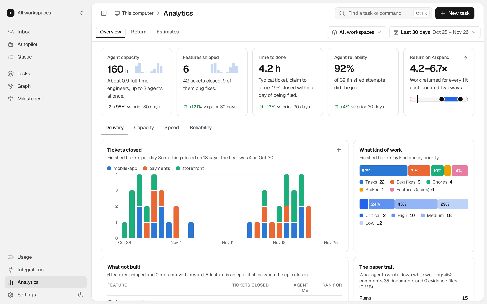
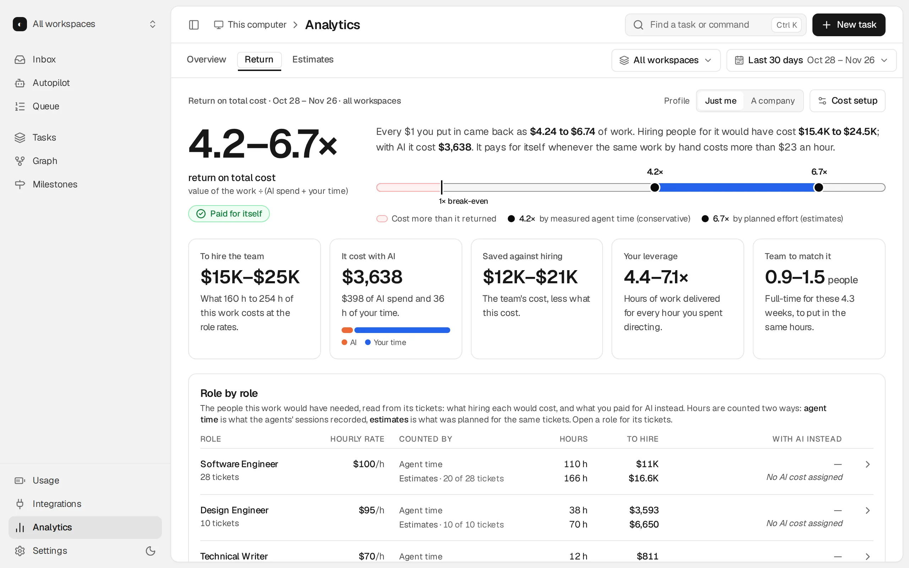
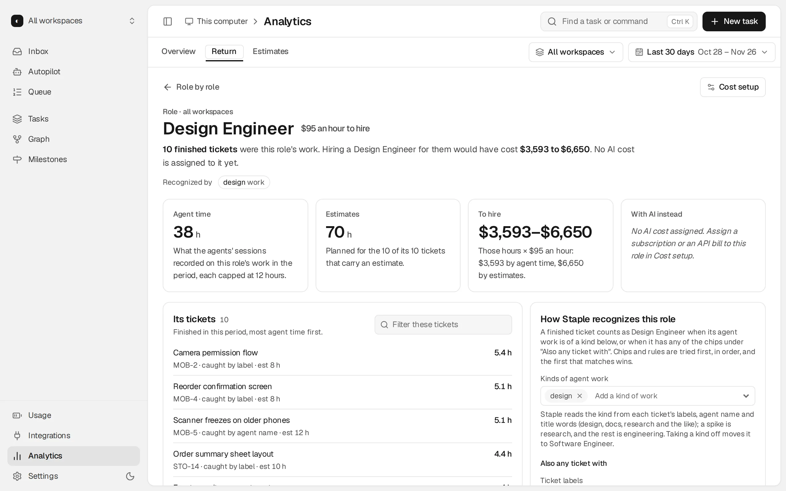
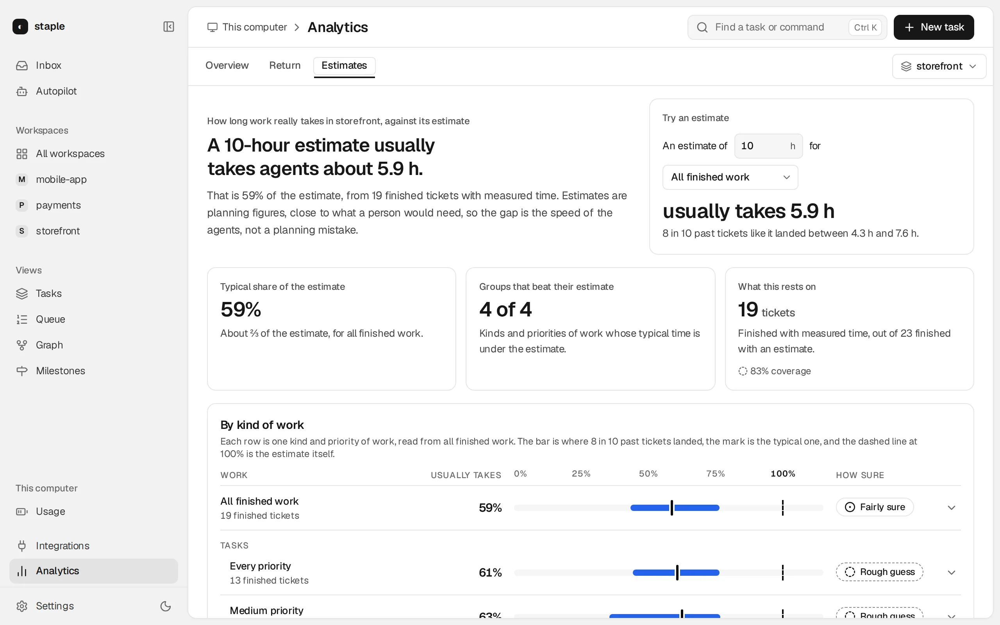

# Analytics

Use this page to answer three questions: *what did the agents deliver?*, *what would
that work have cost to hire, against what I paid for AI?* and *how far off do my
estimates run?* Analytics reads what the tracker already holds, so there is
nothing to set up before the first two lenses show figures.

Analytics is a view of **this computer**: it reads every workspace registered
here. It needs `staple open --hub` to see more than one.

## 1. Open it

**Analytics** is the last row of the rail, under *Integrations*. On a phone it is
in *More*, under *This computer*. `⌘K` then *Go to Analytics* works anywhere.

Beside the page name are three lenses and two filters:

| Control | Does |
| --- | --- |
| *Overview*, *Return*, *Estimates* | The three lenses. Each keeps its own scroll position. |
| The workspace filter | *All workspaces*, or one. Every figure, role and ticket list follows it. |
| The period | The last 7, 30 or 90 days, this year, all time, or a custom range. *Estimates* always reads all finished work, so it has no period. |

The address holds the lens, the workspace and the period, so a link opens the same
page.

## 2. Overview: what the agents delivered

Five figures lead, each with its change against the period before:

| Figure | Means |
| --- | --- |
| **Agent capacity** | Hours agents spent working, and the number of full-time engineers that is over the period. |
| **Features shipped** | Epics that closed, with the tickets closed. |
| **Time to done** | The typical time from an agent claiming a ticket to it being done. |
| **Agent reliability** | The share of finished attempts that did the job. |
| **Return on AI spend** | The return as a range. It opens the *Return* lens. |

Under them, four topics. The topic tabs stay at the top while you scroll.

- **Delivery:** tickets closed over time by workspace, what kind of work it was,
  the features that moved and how much agent time each took, and the bursts the
  work arrived in.
- **Capacity:** agent time over time, where it went, how many agents ran at once,
  and planned effort against agent time.
- **Speed:** how long a ticket takes, the typical time by kind, and the hours of
  the week work lands in.
- **Reliability:** how attempts ended, and which model did the work.

Every chart has a table behind the small table button in its corner, and says so
in words when a figure rests on part of the data (*Partial: 248 of 346 finished
tickets have an estimate*).

## 3. Return: hiring against AI

The Return lens compares two costs for the same work.

- **To hire the team:** the people the work would have needed, at an hourly rate
  each.
- **With AI:** what you paid for AI, plus the time of the person directing the
  agents.

The figure at the top is the **return on total cost**: the first divided by the
second. A scale beside it marks break-even at 1×; left of it, the work cost more
than it returned.

The return is a range, because the hours of work are counted two ways and never
mixed:

| Count | Is | Reads as |
| --- | --- | --- |
| **Agent time** | What the agents' sessions recorded. | The floor. Agents are fast and run in parallel, so a person would have needed longer. |
| **Estimates** | The estimates on the finished tickets. | Closer to what a person would need, but only tickets that carry an estimate count. |

**Role by role** lists the people the work would have needed. staple reads the
roles from the tickets in the workspace and period on screen, so a workspace that
did no documentation has no Technical Writer and pays nothing for one. Each role
shows its two counts, what hiring would cost by each, and the AI you assigned to
it. Your directing time and any AI shared by the whole team are their own rows,
and the rows add up to the total.

Open a role for its page: the four figures with where each comes from, the
tickets it caught with why (the 200 with the most agent time when there are
more), and how staple recognizes it.

### How a role is recognized

staple has no record of what kind of agent did a ticket, so it reads the ticket.
Two things decide the role, and both are on the role's page:

- **Kinds of agent work.** staple sorts every finished ticket into engineering,
  design, documentation, research or orchestration, from its labels, its agent's
  name and the words in its title. Each kind belongs to one role, and you can
  move a kind to another role.
- **Also any ticket with.** Chips you add yourself: a ticket label, a word in the
  title, part of an agent's name, a ticket kind or a whole workspace. A ticket
  that has one of a role's chips is that role's work, whatever its kind.

Chips are tried first, and the role that holds engineering takes whatever nothing
else matched, so every ticket lands on exactly one role. The ticket list beside
the editor says what caught each ticket, and updates once a change is saved.

## 4. Cost setup

Every figure the return rests on is set in **Cost setup**, opened from the Return
lens. It is not part of Settings.

There are two profiles, and each keeps its own figures:

| Profile | For | Leads with |
| --- | --- | --- |
| **Just me** | One person directing agents and paying for their own AI. Your time is counted at what it would earn elsewhere. | *Your AI plans*: each plan, its price a month and how many of it you have. One person's plans serve every role, so they are counted once. |
| **A company** | A company that pays an employee to direct the agents and buys AI for the people in each role. | *The team*: for each role, what the person costs an hour and the seats of a plan or the API bill the company pays for that role. |

In both you set the directing person's hourly rate and hours a day, and what each
role costs an hour. A figure nobody has changed yet wears an **assumed** mark, and
the page counts them, so a default is never read as your own number.

An **API bill** is the monthly figure on your provider's invoice. staple does not
record token use, so it cannot price API usage itself.

Changes are saved as you make them. The setup is kept in one workspace, named at
the foot of the dialog, and covers every workspace on this computer. If that
workspace is connected to [cloud sync](cloud-sync.md) the setup follows you to
your other devices; if it is not, the dialog says *Saved on this computer only*
and **Move** puts it in a workspace that is. *Reset both profiles* clears the two
profiles' figures and keeps your roles and chips.

## 5. Estimates: how far off they run

The Estimates lens says how long work really takes against its estimate.

- One sentence gives the answer (*A 10-hour estimate usually takes agents about
  1.3 h*).
- **Try an estimate:** type a number of hours, pick a kind of work, and read what
  it usually takes and where 8 in 10 past tickets landed.
- **By kind of work:** every kind and priority as one row on one scale, where
  100% is the estimate. The bar is where 8 in 10 past tickets landed and the mark
  is the typical one. A row says how sure the figure is, and opens to the detail.

With *All workspaces* chosen, there is one row per workspace; choose one to see it
by kind of work. Estimate accuracy is worked out for each workspace on its own,
because estimating habits differ between projects. The same report is
`staple calibrate`; see [Budget and estimates](budget-and-estimates.md).

## What the figures do not know

- **Agent time is not human time.** It is the length of the agents' sessions, each
  counted for at most 12 hours so a session left open does not inflate it.
- **Estimates cover part of the work.** Only tickets with an estimate count, and
  each row says how many that is.
- **Roles are a reading, not a record.** They come from the rule you can see and
  change.
- **Your time is your figure.** staple does not record a person's hours: directing
  time is the days agents ran, times the hours a day you enter.
- **AI spend is what you enter.** staple reads no invoices and prices no tokens.
- **The model is often not logged.** Work is grouped by the model each session
  reported. A session that reported only its tool is shown under the tool
  (*Claude, model not logged*), and one that reported neither as *No model
  logged*. Nothing is guessed from the agent's name.

## Next

- [Budget and estimates](budget-and-estimates.md): estimating tickets, and the Usage view.
- [Web UI tour](web-ui.md): every other view.
- [Several repositories](hub.md): one page over every workspace.
