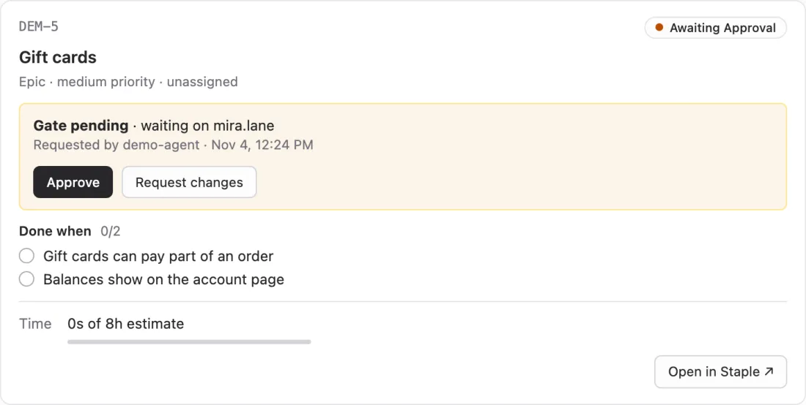
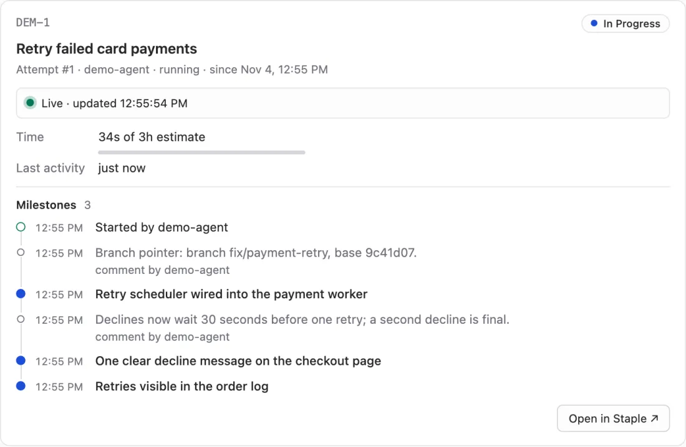
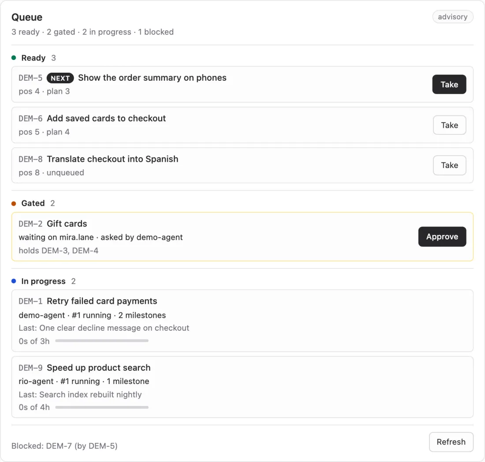
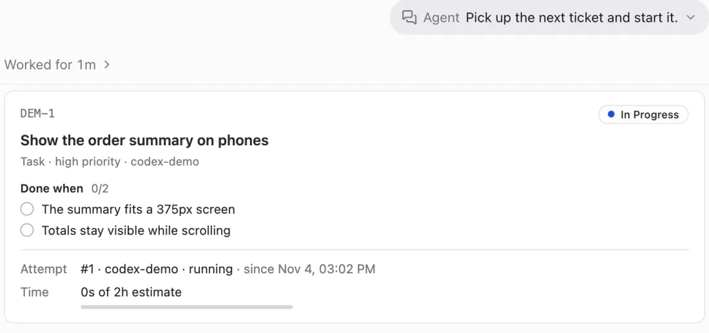

# Views in the thread

Use this page to see what staple shows inside your agent's conversation: a ticket
as a card, a ticket's progress as it happens, and the pickup queue. You read them
where you already talk to the agent, and you answer a gate or hand out work from
there, without switching to the web UI.

The views use [MCP Apps](https://github.com/modelcontextprotocol/ext-apps), an
extension to MCP. A client that supports it draws a tool's view as a small page in
the conversation. Any other client shows the tool's answer as text, so every view
tool works everywhere. There is nothing to install or turn on: the views ship
inside `staple-cli`, and `staple mcp` serves them once your agent is
[connected](connect-your-agent.md).

## The three views

The screenshots come from separate fictional demo workspaces, so the same
ticket number can name different tickets from one picture to the next.

### Ticket card: `show_ticket`



One ticket: its status, kind, priority and assignee, the acceptance criteria with
their marks, the gate and who it waits on, the current attempt, the branch it is
on, and time spent against the estimate.

- While a gate is pending, **Approve** and **Request changes** answer it. They call
  `approve_task` and `request_changes` through your client, which asks you first.
  Request changes asks for a note, which becomes a comment on the ticket
  ([Approval gates](approval-gates.md)).
- **Open in Staple** opens the ticket in the [web UI](web-ui.md), at
  `<base>?ws=<workspace>&issue=<REF>`. The server cannot see a running UI, so it
  builds the base from `STAPLE_UI_URL` when that is set, and otherwise uses
  `http://127.0.0.1:<port>/` with the port `staple ui` tries first
  (`staple config set port`). `STAPLE_UI_URL=off` leaves the button out. The link
  never carries the UI token.
- The branch is the newest branch pointer comment on the ticket (`Branch pointer:
  branch feat/x, base 3f2a1bc.`, see [How an agent works a ticket](working-a-ticket.md)).
  The criteria show as met once the ticket is done; a milestone's show its goal
  check.

`get_task` and `checkout_task` draw the same card, so a ticket an agent reads or
claims over MCP shows up without an extra call.

### Live progress: `show_progress`



How one ticket's current attempt is going: its status, the agent, a timeline of
the milestones it recorded and the comments it posted, time against the estimate,
and its last activity.

The view keeps itself up to date. While the attempt is open it reads
`show_progress` again every few seconds through your client, and each milestone
the agent records shows up without anyone asking. That read changes nothing, so
the client asks nobody before it.

It says when it stops following: when the client refuses its reads twice in a row
(a client whose agent session has ended does), when the client closes the view,
when the attempt ends, and in a client that does not let views call tools.
**Check again** reads once more and picks the refresh back up if that works.

### The queue: `show_queue`



The [pickup queue](queue.md) in lanes: **Ready** in pickup order, **Gated** with
the person each gate waits on, and **In progress** with who holds each ticket and
how its attempt is going. Blocked work is counted at the bottom. `scope` narrows
the lanes to one epic or milestone.

- The first ready row is what `staple queue next` and `next_task` answer, and every
  row they step over shows in Gated, In progress or the blocked line.
- **Take** on a ready row posts "Work DEM-5" into the conversation as your
  message (the client asks you first). The agent that reads it takes the ticket.
  The view claims nothing itself.
- **Approve** on a gated row calls `approve_task` through the client, which asks
  first, then reads the lanes again.
- Under `queue.policy = strict` only the row checkout accepts now has a Take
  button; the others say which row they wait for.

`inbox` and `list_queue` draw the same view.

## When an agent shows each view

The views are display only: they change nothing. The protocol `staple init` writes
into `.staple/AGENTS.md` still keeps agents to these moments, so a conversation is
not buried in cards:

| When | The agent calls | You see |
|---|---|---|
| right after it claims a ticket with `staple checkout` | `show_ticket`, once | the card of the ticket it took |
| after it records a milestone (`staple attempt milestone`, `record_attempt_event`) | `show_progress` | its progress, which then follows every later milestone |
| you ask what is next, what is queued, or what waits on you | `show_queue` | the lanes |
| it hands a ticket on for review, or gates a parent | `show_ticket` | the card, with Approve and Request changes while the gate is pending |

And when not to:

- **One card per claim.** `checkout_task` already draws the card, so an agent that
  claims over MCP does not follow it with `show_ticket`.
- **One progress view per stretch of work.** The view is live, so an agent shows
  it again after a milestone only if it has not shown that ticket's progress since
  you last wrote. It never calls it to refresh.
- **The queue answers you, not the agent.** To choose its own work, an agent asks
  `next_task` (`staple queue next`).

Asked to "pick up the next ticket and start it", an agent that claimed DEM-1 with
`staple checkout` shows its card on its own:



You can always ask for a view yourself: "show me DEM-12", "how is DEM-12 going?",
"what is in the queue?".

`staple init` never overwrites `.staple/AGENTS.md`. To get these rules into a
repository set up before them, move the file aside, run `staple init` again, and
carry your own edits over into the new one.

## Which clients draw the views

MCP Apps is an extension, so support depends on the client. The
[MCP Apps project](https://github.com/modelcontextprotocol/ext-apps) lists Claude,
ChatGPT, VS Code and Goose among the clients that support it, and the
[MCP clients page](https://modelcontextprotocol.io/clients) has the full list.
`staple mcp` runs on your computer over stdio, so you need a client that starts
local MCP servers, such as Claude Desktop, VS Code or Goose.

| Client | What you see |
|---|---|
| T3 Code, in a Codex thread | The views. The screenshots on this page come from one |
| T3 Code, in a Claude thread | Text |
| Claude Code, Codex CLI and other terminal agents | Text |
| Any other client with MCP Apps | It should draw the views, in its light or dark theme. staple's views are tested in T3 Code and in a reference host |

To check a client, ask the agent to call `show_about`. Where views work, it draws
a small card with staple's version, the workspace and its tickets by status.

## What a client without views gets

Each view tool answers with plain text that says the same thing, so an agent in a
terminal can read it to you. `show_ticket DEM-1` on a fictional demo workspace:

```text
DEM-1 Show the order summary on phones
Todo · Task · high priority · unassigned
Estimate 2h, ran 0s.
Done when:
  [ ] The summary fits a 375px screen
  [ ] Totals stay visible while scrolling
```

`show_queue` on the same workspace:

```text
Queue (advisory) · 2 ready · 1 gated · 0 in progress · 1 blocked
Next: DEM-1 Show the order summary on phones
Ready, in pickup order:
  1. DEM-1 Show the order summary on phones
  2. DEM-2 Add saved cards to checkout
Gated, waiting on a person:
  DEM-4 Gift cards: waiting on mira.lane; holds DEM-5. Approve with approve_task.
Blocked: DEM-3 (by DEM-1).
To take one, say "Work DEM-1".
```

`show_progress` lists the status, the time and the milestones the same way.

## What a view can reach

Each view is one HTML file with its script and styles inside, served as a
`ui://staple/<name>` resource. The client draws it in a sandboxed frame with no
network access, follows its own light or dark theme, and passes the view the
tool's answer. A view reads and writes only by calling staple's tools through the
client, so a write goes through the same prompt as any other tool call.

[MCP tools](mcp-tools.md) lists every tool, and
[the MCP tools in detail](../design/mcp-tools.md#mcp-apps-views) has each view's
answer shape.
