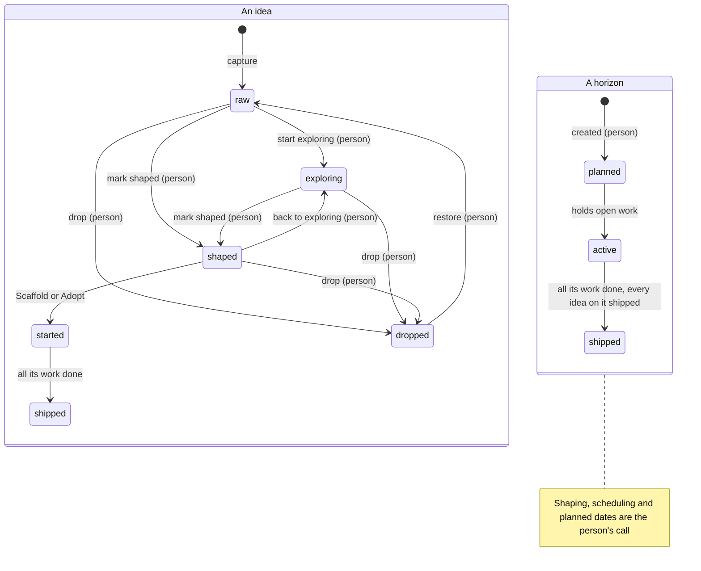

# Planning, from idea to shipped

> [!WARNING]
> **Experimental, and off by default.** Planning may change in any release, including how its
> data is stored. It stays off in a workspace until a person turns it on, and turning it off
> again hides it without deleting anything.

Planning covers the part of the work that comes before tickets. An **idea** holds a plan while
you are still deciding. A **horizon** groups ideas into a delivery slot, such as Now, Next or a
dated release. When an idea is ready, **Scaffold** turns it into an epic with its tasks, and the
horizon tracks that work as a milestone until it ships.

The four things and their jobs:

| Thing | Job |
|---|---|
| Idea | A plan you are still thinking about. It has no ticket number and never shows up as work. |
| Horizon | A column of planned work. Every horizon is a [milestone](milestones.md), so it has progress, a state and a place in the queue. |
| Epic and tasks | The executable work, made from the idea's plan. Agents pick them up like any other tickets. |
| Milestone | Delivery tracking. A horizon's milestone counts its work, the planned work in its ideas too, and reads shipped when all of it is done. |

One idea moves through these states. Each state offers only the actions that fit it, on every
surface (the page, the CLI and the agent tools):



Steps marked (person) are the person's. Restoring a dropped idea can return it to raw,
exploring or shaped. A horizon's state follows the work on it.

## 1. Turn it on

In the web UI, open **Settings → Experimental** and turn on **Planning (experimental)**. At the
terminal, a person with a configured name can do the same:

```bash
staple config set humanName "Your Name"     # once per machine
staple settings set features.planning true --person
```

`features.planning` is a workspace setting, so it syncs to every device on the workspace.
`staple plan enable --person` is another name for the same command. The first time it is turned
on, staple adds the `idea` and `milestone` kinds and two undated horizons, Now and Next.

Agents can read the setting with `staple settings get features.planning`, the `get_setting`
tool or `show_about`. They cannot change it: the tool refuses and tells them to ask you.

## 2. Capture an idea

Open **Plan**. Type in **Capture an idea** in the **Ideas** lens and press Enter. The idea starts
**raw**. It is not a task: it never appears in Tasks, the queue or an agent's `next`, and it takes
no ticket number. On the command line you name an idea by the id `staple idea ls` prints:

```bash
staple idea new "Gift cards at checkout" --brief "Buyers pay with a card balance, alone or split with a card"
staple idea ask <id> "Do gift cards expire?"
```

An idea opens in the same panel as a task. Its **Plan** tab holds the brief, the plan sections,
open questions and decisions. Connections, Documents, Files, Activity, **For agents** (the
payload an agent reads) and **Time** sit beside it. Sub-ideas go under a parent with **Part of**.

## 3. Explore it

Move the idea to **Exploring** while questions are open: drag it, or use the card's ⋯ menu. An
exploring idea can reserve a horizon (it stays in the Ideas lens with a ◇ chip such as ◇ Next)
and get planned dates. Ask questions, answer them, record decisions. Agents help here: they can
add questions, answer them and fill in the plan.

## 4. Shape it

An idea is a plan an agent can build from. The **Plan** tab has ten sections:

- **Goal**★
- Context and constraints
- Decisions
- Open questions
- **Task breakdown**★, a row per task with a key, title, estimate, what it depends on, when it
  is done, an owner and notes
- **Acceptance criteria**★
- Dependencies
- Out of scope
- Risks
- Sources and files

**Mark shaped** works only when the plan passes the shaped gate:

- a goal, acceptance criteria, and at least one breakdown row, every row with a title;
- no two rows with one key, no row depending on a key the breakdown does not hold, and no
  depends-on cycle (a cycle is named by its rows, `1 → 2 → 1`);
- every open question answered or **deferred**, which leaves it open on purpose.

The meter at the top of the Plan tab says what is still missing. A row without its own "done
when" **inherits** the plan's acceptance criteria. The plan shows that, and when the task is
created it carries the label `acceptance-inherited` until someone writes a sharper one.

A shaped idea moves from the Ideas lens to the **Horizons** lens. If someone later edits it so
it no longer passes, it stays shaped and reads **shaped · plan incomplete**, with Scaffold held
back until the plan passes again.

A plan you already have as a file comes in whole:

```bash
staple idea import plans/gift-cards.md --horizon Now --maturity exploring --person
```

The import reads the headings and task tables, attaches the file, and lists anything it kept
under Context because it did not fit the section it was in.

## 5. Schedule it on a horizon

The **Horizons** lens has one column per horizon, then **Unscheduled**, which means no horizon
yet. Drag a shaped idea into a horizon. Give a horizon a date (**add a date**) and it becomes a
release line: it shows on the Timeline and in **Milestones**, and ideas planned past it are
flagged. A horizon without a date is a grouping you chose, like Now or Next. It keeps the same
lifecycle but stays out of the Milestones list.

You never add an idea's work to the horizon's milestone by hand. The work of every idea on a
horizon is the milestone's membership, so moving the idea moves its work. A ticket you put in a
milestone yourself stays where you put it.

Add, rename, date and remove horizons from the column header and **+ Horizon**. Removing one
returns its ideas to Unscheduled. A horizon that still holds open work, or sits in the queue,
cannot be removed until you move that work or take it off the queue. The refusal names what to
move.

## 6. Scaffold, or adopt what exists

Open a shaped idea and press **Scaffold epic and tasks**. It shows a preview first: the epic
(this same record, now with a ticket number) and one task per breakdown row with its estimate,
blockers from depends-on and its done-when. Confirm, and it creates exactly that preview. Each
task also gets a context page, so an agent can work it from the ticket alone. If the plan
changed after the preview, the confirm is refused and you preview again.

```bash
staple idea scaffold <id>                    # preview, prints the fingerprint
staple idea scaffold <id> --confirm <fingerprint>
```

The idea itself becomes the epic and keeps its documents, comments, files and history. Shaped sub-ideas become child epics the same way. Scaffolding again later creates
only rows written since, and a retry never creates a task twice.

Two alternatives:

- **Promote to epic** turns the idea into the epic without creating tasks. Break it down as you
  would any epic.
- **Adopt existing work** links tickets that already exist. An idea can link several.

## 7. From started to shipped

Once it is scaffolded, promoted or linked to work, the idea reads **started**. Its progress and
real dates now come from that work, and it reads **shipped**, with ✓ and the date, when all of it
is done. A horizon reads **active** while it holds open work and **shipped** when its milestone is
done; its column then folds to a ✓ summary.

**What progress counts.** Progress counts work items. A ticket counts once it exists, done or
open, and each breakdown row of an idea that has no tickets yet counts as one **planned** item.
So a horizon whose tickets are nearly all done, with three ideas still waiting to be scaffolded,
reads the share of all its work that is done, not of the tickets alone. The horizon header, its
drawer, the **Milestones** view, `staple horizon ls`, `staple milestone show` and the agent tools
all show the same numbers and the same percentage. An idea with no work, no rows and no
sub-ideas has no size yet: it is counted as **unsized**, never as no work. A parent idea's
sub-ideas carry its size, so its own breakdown, which usually names them, is not counted again;
its rows count once they are tickets. Counts of ideas name the sub-ideas, with the parent counted
apart (`3 ideas (+1 parent)`).

**A horizon waits for its ideas.** A horizon is not shipped while an idea scheduled on it is not:
closing its last ticket leaves it open while another idea on it is still to be built, or still
being explored. Drop the idea or move it to another horizon and the horizon ships on the work it
holds. This holds on every device, and whether planning is on or off.

A parent idea's state is its own. Work under its sub-ideas shows on the parent as progress, dates
and late or not-started counts, but it never starts, ships or reopens the parent.

The planned window an idea has when it starts is kept as its **baseline**. Re-plan later and the
old window stays visible behind the new one, so a slip is easy to see. **Reset baseline to the
plan** in the ⋯ menu makes the current window the new baseline.

## 8. Read the Timeline

The **Timeline** lens draws each idea on a month axis, grouped by horizon:

- **planned**: the window you set. Drag the bar to move it, drag its ends to change the dates;
- **actual**: a solid bar from the first start to the last finish of its work, then dashed to
  the forecast end, hatched where it runs past the plan;
- **baseline**: an outline behind the bar when the plan moved after the work started.

Vertical lines mark today and each dated horizon. An arrow runs from an idea to every idea that
depends on it, red when the dependent one starts first. A dependency counts only when a line of
the Dependencies section starts with the other idea's ticket number, the key its title starts
with (C2 in "C2 Checkout API"), or a row key from its breakdown (42.1).

Two flags, never merged into one count:

- **late** (red): the work finished, or is forecast to finish, after the planned end or the
  horizon's date, or that day has passed while it is open;
- **not started** (amber): nothing is linked or promoted yet, and the planned start has passed.

## 9. Horizons in Tasks

In **Tasks**, every task that belongs to a horizon shows a ◇ chip with its name. On a phone the
chip is short; tap it for the whole name. **Group: Horizon** sections the list by horizon in plan
order, then *No horizon*. The **Horizon** filter keeps the work of the horizons you pick.
Horizons are not rows in Tasks; plain milestones still are.

## 10. Queue a horizon and set how far agents go

A horizon's header has **Queue**, which puts the whole horizon in the [pickup queue](queue.md)
the way queueing a milestone does. It reads *Queued* once it is there.

Beside it is the horizon's **run setting**: how far agents take the horizon when they pick up its
work, and its goal. Nothing starts from it. Agents get it as an instruction with every ticket of
the horizon, through `queue next`, `get_task`, `run continue` and run briefs.

| Setting | What agents do | How it ends |
|---|---|---|
| Until its work is done | Take its work from the queue until every member has landed | Ships with its last member |
| Until its goal is met | A [goal run](runs.md) works the members, checks each criterion with evidence and may add the tickets the goal still needs | Waits for your approval to close |
| Stop for review after each epic | Finish one epic and stop until you release the next | Ships with its last member |

With no setting, agents work the horizon like any milestone. A goal run over a horizon is
refused unless you chose **Until its goal is met**. Stopping that run does not approve the goal;
the horizon reads *Waiting for your approval* until you approve it or request changes.

```bash
staple horizon set Now --run goal --goal "Gift cards pay at checkout" --person
```

## 11. Turn it off

Turn **Planning (experimental)** off in **Settings → Experimental**, or run
`staple settings set features.planning false --person`. Then:

- Plan, its lenses, the idea tabs, the palette commands and the Tasks horizon chip, grouping and
  filter disappear.
- Planning commands, tools and routes refuse with one sentence that says planning is off.
- Pickup answers and run briefs carry no horizon run settings.
- Horizons read as plain milestones and scaffolded epics as ordinary epics.
- Ideas stay unnumbered drafts, never tasks or pickup work.

Nothing is deleted. Turn it on again and ideas, horizons, plan sections, links and run settings
come back as they were.

## What agents can and cannot do

> [!IMPORTANT]
> **Agents capture and write. The person steers.**
>
> Agents can capture raw ideas, edit titles and briefs, write plan sections and breakdown rows,
> add, answer and defer questions, record decisions, adopt or unlink work, and scaffold or
> promote an idea **you** marked shaped (preview first, then confirm).
>
> Agents cannot move maturity, schedule ideas on horizons, set dates or order, re-parent ideas,
> reset baselines, create or change horizons, set a horizon's run setting, or turn planning on or
> off. These need you, in the web UI or with `--person` on the CLI, which records the change
> under your name. An agent that tries gets a `validation` refusal saying what it may do instead.

## What each state offers

| State | Offers |
|---|---|
| Raw | Edit, ask, decide, start exploring, mark shaped, drop, move under another idea, reorder |
| Exploring | The same, plus schedule on a horizon and plan dates |
| Shaped | Edit, schedule, plan dates, scaffold, promote, adopt, back to exploring, drop |
| Started | Re-plan, adopt more work, unlink work, reset the baseline, open the epic; scaffold again only if it was scaffolded |
| Shipped | Open the epic, or link more work (open work reopens it). An idea that was never promoted takes no more edits. |
| Dropped | Restore |
| Horizon planned | Rename, date, reorder, run setting, remove |
| Horizon active | Rename, date, reorder, queue, run setting |
| Horizon shipped | Remove |

A raw idea is never scheduled or promoted, and a started idea never offers promotion again. Ask
for an action a state does not offer and the refusal names the state and what it offers.

## Reference

| CLI | MCP | What |
|---|---|---|
| `staple idea ls`, `staple plan show` | `list_ideas` | Horizons and ideas with state and flags |
| `staple idea show <id>` | `get_idea` | One idea: plan, questions, decisions, links and what it offers |
| `staple horizon ls` | `list_horizons` | Horizons in order, with their run setting |
| `staple idea new` | `capture_idea` | Capture a raw idea |
| `staple idea set`, `ask`, `resolve`, `defer`, `decide` | `update_idea` | Edit an idea and its questions |
| `staple idea plan`, `task` | `update_idea` (`plan`) | Write plan sections and breakdown rows |
| `staple idea import <plan.md>` | | Capture an idea from a plan file |
| `staple idea scaffold [--confirm FP]` | `scaffold_idea` | Preview, then create the epic and its tasks |
| `staple idea promote`, `adopt` | `start_idea` | Promote the idea in place, or adopt a ticket |
| `staple idea unlink` | `unlink_idea` | Remove a link |
| `staple idea reset-baseline --person` | | Make the current window the baseline |
| `staple horizon new`, `set`, `mv`, `rm` (`--person`) | | Define horizons and their run setting |

The full command list is in the [CLI reference](cli.md#the-plan) and the tools in
[MCP tools](mcp-tools.md#planning). The design contract is
[design/plan.md](https://github.com/vpetkovic/staple-tracker/blob/master/design/plan.md).

## Next

- [Milestones and goals](milestones.md): what a horizon's milestone tracks.
- [The pickup queue](queue.md): how a queued horizon expands to its work.
- [Autopilot runs](runs.md): goal runs over a horizon.
