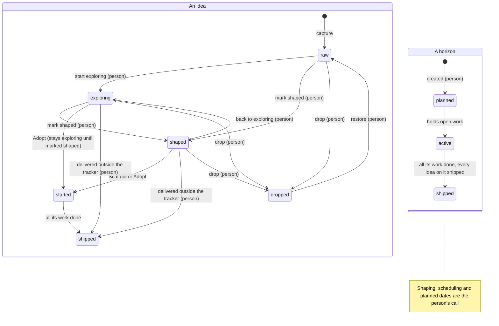

# Planning, from idea to shipped

> [!WARNING]
> **Experimental, and off by default.** Planning may change in any release, including how its
> data is stored. It stays off in a workspace until a person turns it on, and turning it off
> again hides it without deleting anything.

Planning covers the part of the work that comes before tickets. An **idea** holds a plan while
you are still deciding. A **horizon** groups ideas into a delivery slot, such as Now, Next or a
dated release. When an idea is ready, **Scaffold** turns it into an epic with its tasks, and the
horizon tracks that work as a milestone until it ships.

The four things and their jobs:

| Thing | Job |
|---|---|
| Idea | A plan you are still thinking about. It has no ticket number and never shows up as work. |
| Horizon | A column of planned work. Every horizon is a [milestone](milestones.md), so it has progress, a state and a place in the queue. |
| Epic and tasks | The executable work, made from the idea's plan. Agents pick them up like any other tickets. |
| Milestone | Delivery tracking. A horizon's milestone counts its work, the planned work in its ideas too, and reads shipped when all of it is done. |

One idea moves through these states. Each state offers only the actions that fit it, on every
surface (the page, the CLI and the agent tools):



Steps marked (person) are the person's. Restoring a dropped idea can return it to raw,
exploring or shaped. A horizon's state follows the work on it.

## 1. Turn it on

In the web UI, open **Settings → Experimental** and turn on **Planning (experimental)**. At the
terminal, a person with a configured name can do the same:

```bash
staple config set humanName "Your Name"     # once per machine
staple settings set features.planning true --person
```

`features.planning` is a workspace setting, so it syncs to every device on the workspace.
`staple plan enable --person` is another name for the same command. The first time it is turned
on, staple adds the `idea` and `milestone` kinds and two undated horizons, Now and Next.

Agents can read the setting with `staple settings get features.planning`, the `get_setting`
tool or `show_about`. They cannot change it: the tool refuses and tells them to ask you.

## 2. Capture an idea

Open **Plan**. Type in **Capture an idea** in the **Ideas** lens and press Enter. The idea starts
**raw**. It is not a task: it never appears in Tasks, the queue or an agent's `next`, and it takes
no ticket number. On the command line you name an idea by the id `staple idea ls` prints:

```bash
staple idea new "Gift cards at checkout" --brief "Buyers pay with a card balance, alone or split with a card"
staple idea ask <id> "Do gift cards expire?"
```

An idea opens in the same panel as a task. Its **Plan** tab holds the brief, the plan sections,
open questions and decisions. Connections, Documents, Files, Activity, **For agents** (the
payload an agent reads) and **Time** sit beside it. Sub-ideas go under a parent with **Part of**.

## 3. Explore it

Move the idea to **Exploring** while questions are open: drag it, or use the card's ⋯ menu. An
exploring idea can reserve a horizon (it stays in the Ideas lens with a ◇ chip such as ◇ Next)
and get planned dates. Ask questions, answer them, record decisions. Agents help here: they can
add questions, answer them and fill in the plan.

## 4. Shape it

An idea is a plan an agent can build from. The **Plan** tab has ten sections:

- **Goal**★
- Context and constraints
- Decisions
- Open questions
- **Task breakdown**★, a row per task with a key, title, estimate, what it depends on, when it
  is done, an owner and notes
- **Acceptance criteria**★
- Dependencies
- Out of scope
- Risks
- Sources and files

**Mark shaped** works only when the plan passes the shaped gate:

- a goal, acceptance criteria, and at least one breakdown row, every row with a title. A parent
  whose work is its sub-ideas needs no rows of its own: one sub-idea that is not dropped stands
  in for the breakdown;
- no two rows with one key, no row depending on a key the breakdown does not hold, and no
  depends-on cycle (a cycle is named by its rows, `1 → 2 → 1`);
- every open question answered or **deferred**, which leaves it open on purpose.

The meter at the top of the Plan tab says what is still missing. A row without its own "done
when" **inherits** the plan's acceptance criteria. The plan shows that, and when the task is
created it carries the label `acceptance-inherited` until someone writes a sharper one.

A shaped idea moves from the Ideas lens to the **Horizons** lens. If someone later edits it so
it no longer passes, it stays shaped and reads **shaped · plan incomplete**, with Scaffold held
back until the plan passes again.

A plan you already have as a file comes in whole:

```bash
staple idea import plans/gift-cards.md --horizon Now --maturity exploring --person
```

The import reads the headings and task tables, attaches the file, and lists anything it kept
under Context because it did not fit the section it was in. An imported idea has no sub-ideas
yet, so importing straight into shaped needs breakdown rows; import a parent as exploring, add
its sub-ideas, then mark it shaped.

## 5. Schedule it on a horizon

The **Horizons** lens has one column per horizon, then **Unscheduled**, which means no horizon
yet. Drag a shaped idea into a horizon. Give a horizon a date (**add a date**) and it becomes a
release line: it shows on the Timeline and in **Milestones**, and ideas planned past it are
flagged. A horizon without a date is a grouping you chose, like Now or Next. It keeps the same
lifecycle but stays out of the Milestones list.

You never add an idea's work to the horizon's milestone by hand. The work of every idea on a
horizon is the milestone's membership, so moving the idea moves its work. A ticket you put in a
milestone yourself stays where you put it.

Add, rename, date and remove horizons from the column header and **+ Horizon**. Removing one
returns its ideas to Unscheduled. A horizon that still holds open work, or sits in the queue,
cannot be removed until you move that work or take it off the queue. The refusal names what to
move.

### How a horizon reads

A horizon reads the same in three places: its column in the **Horizons** lens, its drawer, and
its detail in **Milestones**. Each shows the same header and the same tree.

The header says `3 ideas (+1 parent) · 2 members`: the ideas on it, with parent ideas counted
apart, and the tickets in its milestone. Below that are its ideas by state
(`1 shipped · 1 started · 1 exploring`), a bar split into done, open and planned work with its
percentage, and **Needs you: n** when n of its next steps wait on you.

Under the header each parent idea is a group. Its sub-ideas sit indented under it, always
visible on a desk. Each one shows its own state, its own bar, its open questions and what it needs
next, in a few words:

| it reads | meaning |
|---|---|
| starts Dec 1 / waits on Audit trail | shaped, not its turn yet: its planned start is later, or an idea it depends on has not shipped |
| ready to scaffold | its turn has come: an agent can build its tickets |
| needs you: 2 questions | still being explored, with questions for you |
| plan needed | its plan is missing something the shaped gate asks for |
| ready to mark shaped | its plan is complete: mark it shaped |
| to develop | a sub-idea not developed yet |

A sub-idea scheduled on another horizon, or on none, is shown dimmed with *on Later* or
*unscheduled*. It counts there, not here. An idea still being explored that you scheduled on the
horizon shows as a **reserved row**: its state and questions, with no card and no drag. It is also
still a card in the **Ideas** lens. An idea delivered outside the tracker shows ✓ Shipped with
*outside the tracker*.

On a phone, each group starts folded. **Show sub-ideas** opens it, and nothing is dragged; use
a card's ⋯ menu to move it. Every number comes from the server, so the three places always agree.
A horizon at `100% incomplete` stays open and is never folded away.

## 6. Scaffold, or adopt what exists

Open a shaped idea and press **Scaffold epic and tasks**. It shows a preview first: the epic
(this same record, now with a ticket number) and one task per breakdown row with its estimate,
blockers from depends-on and its done-when. Confirm, and it creates exactly that preview. Each
task also gets a context page, so an agent can work it from the ticket alone. If the plan
changed after the preview, the confirm is refused and you preview again.

```bash
staple idea scaffold <id>                    # preview, prints the fingerprint
staple idea scaffold <id> --confirm <fingerprint>
```

The idea itself becomes the epic and keeps its documents, comments, files and history. Shaped sub-ideas become child epics the same way. A parent with no rows of its own becomes its epic and
its shaped sub-ideas' epics, and no task of its own; a sub-idea still exploring stays an idea and
is not in the preview. Scaffolding again later creates only what is missing: rows written since,
and sub-ideas shaped since, as child epics. A retry never creates anything twice. So when you
shape a sub-idea after its parent was scaffolded, scaffold the parent again (or the sub-idea on
its own). A parent scaffolded with no rows of its own can be scaffolded again while it stays
rowless; once it gains rows of its own, it offers Scaffold again only after a task of one of them
exists, so until then scaffold the new sub-idea on its own.

Two alternatives:

- **Promote to epic** turns the idea into the epic without creating tasks. Break it down as you
  would any epic.
- **Adopt existing work** links tickets that already exist. An idea can link several. An
  exploring idea can adopt too, when tickets already exist for something still being worked out.
  It then reads started, but its maturity stays exploring: you can still mark it shaped, and its
  questions are still asked, answered and deferred.

## 7. From started to shipped

Once it is scaffolded, promoted or linked to work, the idea reads **started**. Its progress and
real dates now come from that work, and it reads **shipped**, with ✓ and the date, when all of it
is done. A horizon reads **active** while it holds open work and **shipped** when its milestone is
done; its column then folds to a ✓ summary.

**What progress counts.** Progress counts work items. A ticket counts once it exists, done or
open, and each breakdown row of an idea that has no tickets yet counts as one **planned** item.
So a horizon whose tickets are nearly all done, with three ideas still waiting to be scaffolded,
reads the share of all its work that is done, not of the tickets alone. The horizon header, its
drawer, the **Milestones** view ([How a horizon reads](#how-a-horizon-reads)), `staple horizon ls`, `staple milestone show` and the agent tools
all show the same numbers and the same percentage. An idea with no work, no rows and no
sub-ideas has no size yet: it is counted as **unsized**, never as no work. A parent idea's
sub-ideas carry its size, so its own breakdown, which usually names them, is not counted again;
its rows count once they are tickets. Counts of ideas name the sub-ideas, with the parent counted
apart (`3 ideas (+1 parent)`). Every surface prints the same whole percent, rounded down; a
horizon whose counted work has all landed while an idea on it has no size yet, or is not shipped,
reads `100% incomplete`, never plain 100%.

**A horizon waits for its ideas.** A horizon is not shipped while an idea scheduled on it is not:
closing its last ticket leaves it open while another idea on it is still to be built, or still
being explored. A parent idea scheduled on a horizon brings its sub-ideas with it: a sub-idea
with no horizon of its own counts, and waits, on its parent's horizon, and one you schedule on
another horizon counts there instead. Drop the idea or move it to another horizon and the horizon
ships on the work it holds. This holds on every device, and whether planning is on or off: with
planning off, `staple milestone show` prints `held by plan` with how many ideas hold it, and
closing it by hand is refused with the same count and a note to turn planning on to see them.

A parent idea's state is its own. Work under its sub-ideas shows on the parent as progress, dates
and late or not-started counts, but it never starts, ships or reopens the parent.

The planned window an idea has when it starts is kept as its **baseline**. Re-plan later and the
old window stays visible behind the new one, so a slip is easy to see. **Reset baseline to the
plan** in the ⋯ menu makes the current window the new baseline.

### Delivered outside the tracker

Some work shipped before the tracker existed, or somewhere it does not reach. Mark the idea
**delivered outside the tracker** instead of inventing a ticket for it. Open it, and in the Plan
tab set the day it was delivered and, if you like, a note about where and how. It then reads
**shipped**, with ✓, the day and *outside the tracker* on its card, and takes no ticket number.

```bash
staple idea set <id> --delivered 2026-10-03 --note "Shipped by hand before the tracker" --person
staple idea set <id> --undelivered --person      # clear the mark
```

An exploring or shaped idea offers the mark. The delivery day is the idea's actual end, so it reads
**late** only when that day is after its planned end or its horizon's date. A marked idea can still
be renamed and given a new brief, questions and decisions; **Clear the delivered mark** puts it back
where it was. Linking open work to it later reopens it, as it would any shipped idea; from then on
its window and lateness follow that work, and once it lands the idea's end is the later of the
delivery day and the work's end.

A marked idea counts as done work: its breakdown rows, at least one, all done, on its own bar, in
its parent's rollup and on its horizon, where `milestone show` names them as delivered outside the
tracker. It no longer holds its horizon open.

## 8. Read the Timeline

The **Timeline** lens draws each idea on a month axis, grouped by horizon:

- **planned**: the window you set. Drag the bar to move it, drag its ends to change the dates;
- **actual**: a solid bar from the first start to the last finish of its work, then dashed to
  the forecast end, hatched where it runs past the plan;
- **baseline**: an outline behind the bar when the plan moved after the work started.

Vertical lines mark today and each dated horizon. An arrow runs from an idea to every idea that
depends on it, red when the dependent one starts first. A dependency counts only when a line of
the Dependencies section starts with the other idea's ticket number, the key its title starts
with (C2 in "C2 Checkout API"), or a row key from its breakdown (42.1). A key two ideas share
counts for neither, except that a sub-idea's title key wins over the same key on a row of any of
its ancestors: when a parent's rows are keyed R1, R2 like its sub-ideas, a sibling's "R1" names
the sub-idea. An idea never depends on its own parent or sub-ideas, at any depth: the parent's
own "R1" is its own row, and a sub-idea naming a key only its parent's rows hold depends on
nothing. No arrow runs between an idea and its parent.

Two flags, never merged into one count:

- **late** (red): the work finished, or is forecast to finish, after the planned end or the
  horizon's date, or that day has passed while it is open;
- **not started** (amber): nothing is linked or promoted yet, and the planned start has passed.

## 9. Horizons in Tasks

In **Tasks**, every task that belongs to a horizon shows a ◇ chip with its name. On a phone the
chip is short; tap it for the whole name. **Group: Horizon** sections the list by horizon in plan
order, then *No horizon*. The **Horizon** filter keeps the work of the horizons you pick.
Horizons are not rows in Tasks; plain milestones still are.

## 10. Queue a horizon and set how far agents go

A horizon's header has **Queue**, which puts the whole horizon in the [pickup queue](queue.md)
the way queueing a milestone does. It reads *Queued* once it is there.

Beside it is the horizon's **run setting**: how far agents take the horizon when they pick up its
work, and its goal. Nothing starts from it. Agents get it as an instruction with every ticket of
the horizon, through `queue next`, `get_task`, `run continue` and run briefs.

| Setting | What agents do | How it ends |
|---|---|---|
| Until its work is done | Take its work from the queue until every member has landed | Ships with its last member |
| Until its goal is met | A [goal run](runs.md) works the members, checks each criterion with evidence and may add the tickets the goal still needs | Waits for your approval to close |
| Stop for review after each epic | Finish one epic and stop until you release the next | Ships with its last member |

With no setting, agents work the horizon like any milestone. A goal run over a horizon is
refused unless you chose **Until its goal is met**. Stopping that run does not approve the goal;
the horizon reads *Waiting for your approval* until you approve it or request changes.

```bash
staple horizon set Now --run goal --goal "Gift cards pay at checkout" --person
```

### What agents do with the ideas that are not tickets yet

A horizon also hands agents its **plan steps**: for each idea it carries that still needs
planning, what it needs next and who acts. Agents get them beside the ticket on every pickup
(`queue next`, `next_task`, `run continue`), and as the `horizon-plan` instruction on every ticket
of the horizon. They take tickets first; with none left, they take the first step that is theirs
and stop for you on the rest.

| The idea | Step | Who |
|---|---|---|
| Exploring, with open questions | Answer the questions (deferred ones are left out) | You: the agent brings them to you and records your answers |
| Exploring, the plan not written enough to shape | Write the plan sections the gate names | Agent |
| Exploring, ready to shape | Mark it shaped | You |
| Shaped, but edited since so it fails the gate | Fix the plan | Agent |
| Shaped, no tickets, its planned start ahead or an idea it depends on not shipped | Wait | Nobody yet |
| Shaped, no tickets, its turn has come | Re-check the breakdown, then Scaffold (or Adopt) | Agent |
| Raw, or exploring but not scheduled itself, under a scheduled idea | Brainstorm it | Agent |

A shaped idea with no tickets is not a to-do: it **waits** until its planned start (or its
parent's, when it has none) or until the ideas it depends on ship, and agents never scaffold it
before then. A parent whose sub-ideas are not all due waits too, since scaffolding it would build
them; agents scaffold its due sub-ideas one by one instead. To release one early, move its planned
start. When a horizon has no ticket left and
still lists steps, a run over it stops with `planning_needed`, lists the steps (the agent takes
the first one that is its own, and stops for you on the rest) and, when they all wait, says when
the earliest one starts. The horizon itself stays
*planned* (nothing to queue) until its ideas become tickets.

## 11. Turn it off

Turn **Planning (experimental)** off in **Settings → Experimental**, or run
`staple settings set features.planning false --person`. Then:

- Plan, its lenses, the idea tabs, the palette commands and the Tasks horizon chip, grouping and
  filter disappear.
- Planning commands, tools and routes refuse with one sentence that says planning is off.
- Pickup answers and run briefs carry no horizon run settings, no plan steps and no
  `horizon-plan` instruction, and a run never stops with `planning_needed`.
- Horizons read as plain milestones and scaffolded epics as ordinary epics.
- Ideas stay unnumbered drafts, never tasks or pickup work.

Nothing is deleted. Turn it on again and ideas, horizons, plan sections, links and run settings
come back as they were.

## What agents can and cannot do

> [!IMPORTANT]
> **Agents capture and write. The person steers.**
>
> Agents can capture raw ideas, edit titles and briefs, write plan sections and breakdown rows,
> add, answer and defer questions, record decisions, adopt or unlink work, and scaffold or
> promote an idea **you** marked shaped (preview first, then confirm).
>
> Agents cannot move maturity, schedule ideas on horizons, set dates or order, re-parent ideas,
> mark an idea delivered outside the tracker, reset baselines, create or change horizons, set a horizon's run setting, or turn planning on or
> off. These need you, in the web UI or with `--person` on the CLI, which records the change
> under your name. An agent that tries gets a `validation` refusal saying what it may do instead.

## What each state offers

| State | Offers |
|---|---|
| Raw | Edit, ask, decide, start exploring, mark shaped, drop, move under another idea, reorder |
| Exploring | The same, plus schedule on a horizon, plan dates, adopt existing work and mark delivered outside the tracker |
| Shaped | Edit, schedule, plan dates, scaffold, promote, adopt, mark delivered outside the tracker, back to exploring, drop |
| Started | Re-plan, adopt more work, unlink work, reset the baseline, open the epic; scaffold again only if it was scaffolded; mark shaped if it started while exploring |
| Shipped | Open the epic, or link more work (open work reopens it). An idea that was never promoted takes no more edits, unless it was marked delivered outside the tracker: then it is still edited, and you can clear the mark. |
| Dropped | Restore |
| Horizon planned | Rename, date, reorder, run setting, remove |
| Horizon active | Rename, date, reorder, queue, run setting |
| Horizon shipped | Remove |

A raw idea is never scheduled, promoted or linked to work, and a started idea never offers
promotion again. Ask for an action a state does not offer and the refusal names the state and
what it offers.

## Reference

| CLI | MCP | What |
|---|---|---|
| `staple idea ls`, `staple plan show` | `list_ideas` | Horizons and ideas with state and flags |
| `staple idea show <id>` | `get_idea` | One idea: plan, questions, decisions, links and what it offers |
| `staple horizon ls` | `list_horizons` | Horizons in order, with their run setting and plan steps |
| `staple idea new` | `capture_idea` | Capture a raw idea |
| `staple idea set`, `ask`, `resolve`, `defer`, `decide` | `update_idea` | Edit an idea and its questions |
| `staple idea set --delivered D [--note T] --person`, `--undelivered` | | Mark an idea delivered outside the tracker, or clear the mark |
| `staple idea plan`, `task` | `update_idea` (`plan`) | Write plan sections and breakdown rows |
| `staple idea import <plan.md>` | | Capture an idea from a plan file |
| `staple idea scaffold [--confirm FP]` | `scaffold_idea` | Preview, then create the epic and its tasks |
| `staple idea promote`, `adopt` | `start_idea` | Promote the idea in place, or adopt a ticket |
| `staple idea unlink` | `unlink_idea` | Remove a link |
| `staple idea reset-baseline --person` | | Make the current window the baseline |
| `staple horizon new`, `set`, `mv`, `rm` (`--person`) | | Define horizons and their run setting |

The full command list is in the [CLI reference](cli.md#the-plan) and the tools in
[MCP tools](mcp-tools.md#planning). The design contract is
[design/plan.md](https://github.com/vpetkovic/staple-tracker/blob/master/design/plan.md).

## Next

- [Milestones and goals](milestones.md): what a horizon's milestone tracks.
- [The pickup queue](queue.md): how a queued horizon expands to its work.
- [Autopilot runs](runs.md): goal runs over a horizon.
