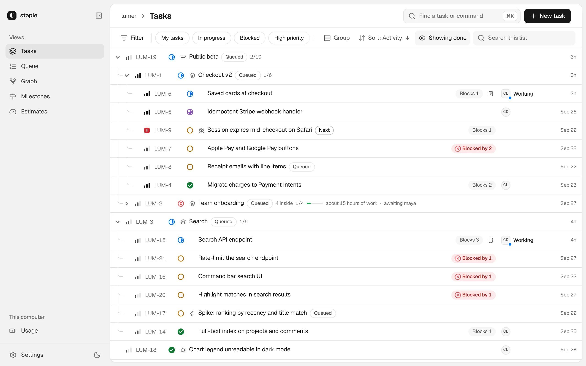
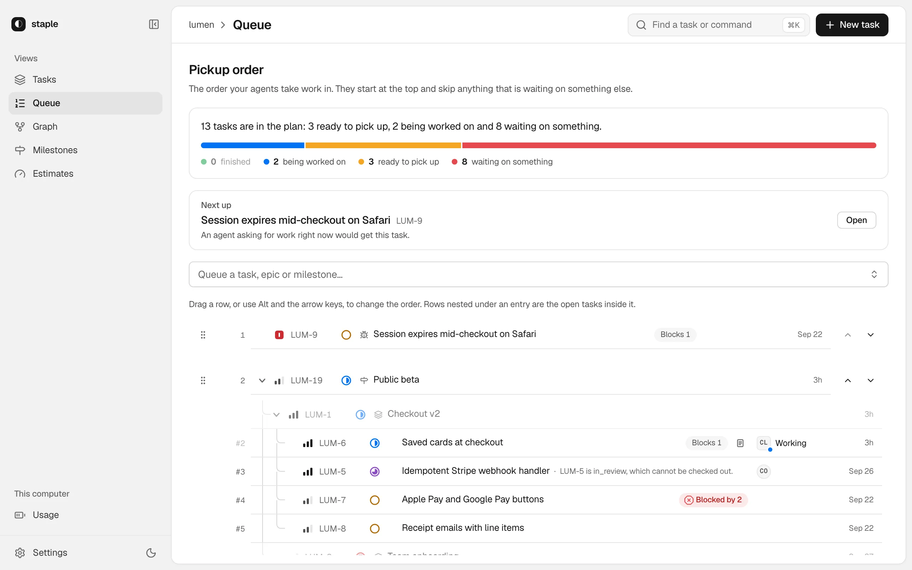
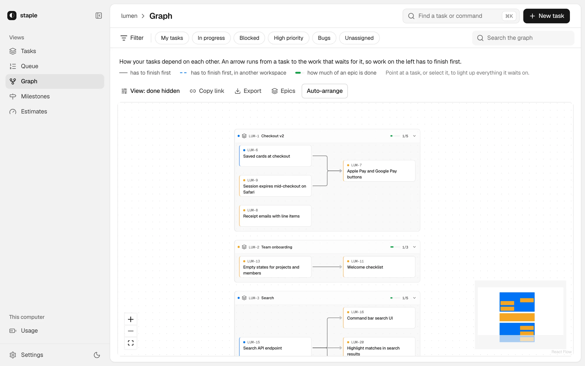
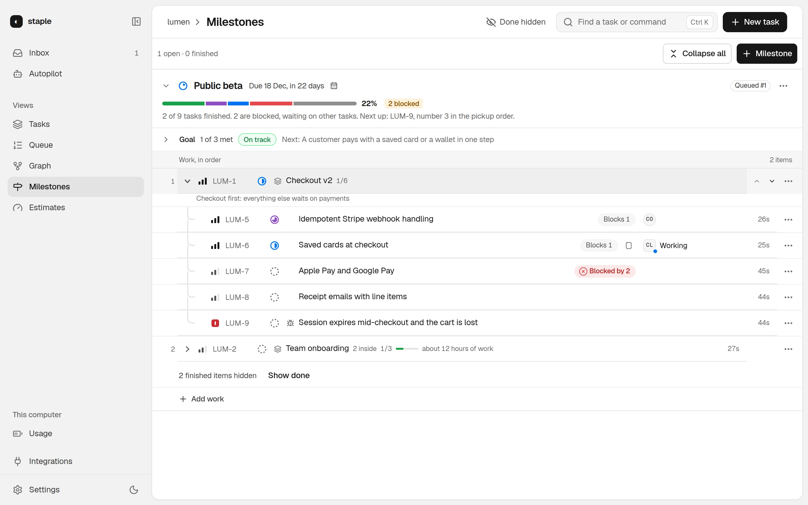
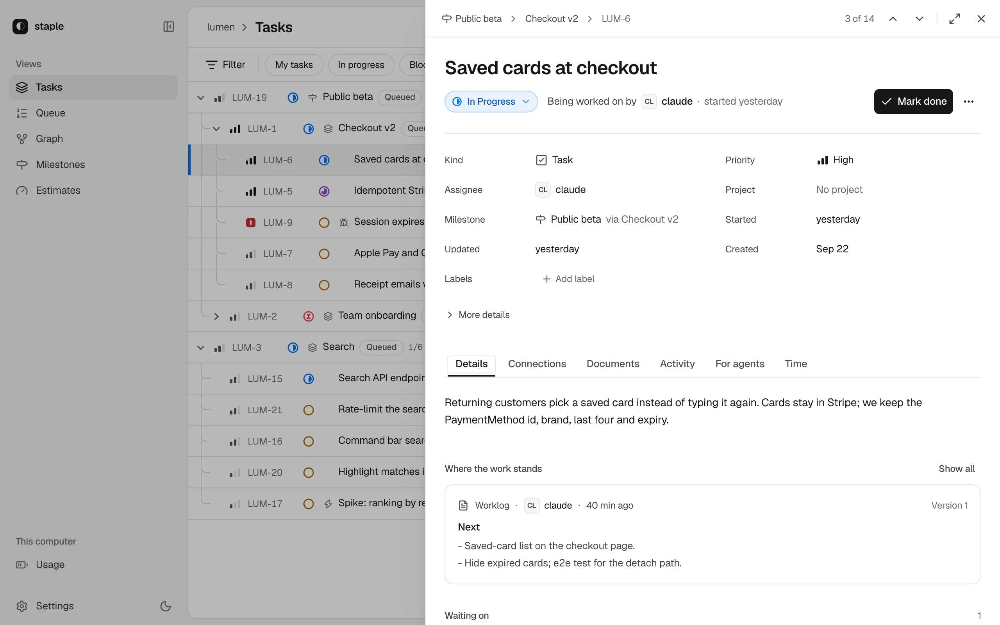

# Web UI tour

Use the web UI to see the whole plan at once and steer it: what is ready, what is
blocked, what agents hold and what needs you. It works on the same tickets as the
CLI and MCP, so a change made anywhere shows up here within seconds.

The screenshots show a demo workspace called `lumen` (prefix `LUM`).

## 1. Open it

```bash
staple open
```

```text
staple ui — workspace "app" at http://localhost:4400/
  (browser on this machine needs no token; API callers use ~/.staple/ui-token or ?token=25nHEhaY…)
```

Your browser opens on this repository's workspace. The server listens on this
machine only and stops on Ctrl-C.

- `staple open --port 4410` picks the port. Without `--port`, staple takes 4400,
  or a free port when 4400 is busy.
- `staple open --hub` shows every workspace on this machine at once. See
  [Several repositories](hub.md).
- `staple open --no-browser` starts the server without opening a tab.

## 2. Find your way around

On a wide screen the **rail** on the left starts with *Inbox* (what waits on you,
with a count) and *Autopilot* (agent runs, with a line per live run). Under them are
the workspaces and the views: *Tasks*, *Queue*, *Graph*, *Milestones* and
*Estimates*, then *Usage* under *This computer*, and *Settings* with the dark-mode
switch at the foot. The page follows your system's light or dark setting until you
use that switch. The **top bar** names where you
are, shows the sync state if the workspace uses [cloud sync](cloud-sync.md), and
holds the search field and **New task**.

| Keys | Does |
| --- | --- |
| `⌘K` / Ctrl-K | the command palette: jump to a view, a task or a setting |
| `c` | New task |
| `[` | hide or show the rail |
| `j` / `k` | next or previous task while one is open |
| Escape | close what is open |

Below 768 px the UI becomes a phone app with a tab bar: *Inbox*, *Autopilot*,
*Tasks*, *Queue* and *More*, which holds the other views. The address
always describes the page, filters included, so you can bookmark or share a view.

## 3. Tasks: the whole tree



Every ticket, parents over children. Each row shows its status, what it waits on
(*Blocked by 2*), what waits on it, and who holds it (*Working*). A folded epic
shows its progress.

The **quick filters** (*My tasks*, *In progress*, *Blocked*, *High priority*),
**Filter**, **Group**, **Sort** and search shape the list. Change a status from its
icon, and click a ticket to open it (step 7).

## 4. Queue: what agents take next



The [pickup queue](queue.md) as one list. **Next up** names the ticket an agent
asking now would get; below it, your plan in order, each queued epic or milestone
expanded into its tickets. Drag rows (or Alt-↑ and Alt-↓) to reorder; *Queue a
task, epic or milestone…* adds work, and a row's `⋯` menu removes it.

### Inbox: what waits on you

The work only a person can move, one row per thing: gates waiting on approval
(resubmitted ones apart), blockers a person owns, tickets in review, tickets made
ready again because their blockers in other workspaces closed, stopped autopilot
runs, live runs whose driver stopped (they take nothing until a driver attaches or
you stop them), claims silent past `queue.silentClaimMinutes`, and sync conflicts.

A row says what it is, why it waits and for how long. A blocker you own prints what
you have to do. Click a row to act on it: a gate, a review or a blocker opens the
ticket, a stopped or stalled run opens the run, and a sync conflict opens in place
with both values and asks which to keep. A silent claim only opens the ticket;
taking work over stays explicit. Rows you can clear without acting (a stopped run,
a ticket made ready again) have a dismiss button.

Sections fold. Rows that are new since you last looked carry a dot, and so does
the *Inbox* row in the rail. The count beside *Inbox* is every workspace's total;
a page narrowed to one workspace says how many more wait elsewhere. With a ticket
open from the Inbox, the drawer's previous and next walk the list, and it moves to
the next row when the one you were on leaves.

| Keys | Does |
| --- | --- |
| `↑` `↓` or `k` `j` | move between rows |
| Enter | act on the row |
| `e` | dismiss a row that can be dismissed |
| `→` `←` | open or close a sync conflict |

`staple attention` prints the same rows.

## 5. Graph: how work depends on work



Tickets that take part in a dependency, inside boxes for their epics, with an arrow
from each ticket to the work that waits on it. Hover a ticket to light up the chain
it waits on, and use the **Epics** picker to narrow the canvas.

## 6. Milestones: dated plans



Each open [milestone](milestones.md) is a section, in plan order. Its header gives
the due date, a progress bar, what needs you (*Waiting for your approval*, *2
blocked*, *behind*) and a line of facts ending in what comes next. Click the name
to open the milestone's details. Its status, its due date and its place in the
queue are in the header's **⋯** menu.

Under the header:

- **Goal** says how many criteria are met and whether the milestone is on pace.
  Click it to see each criterion with its verdict and evidence. It opens by
  itself when the milestone waits for your approval or all its work is finished.
- **Plan**, on a horizon only, unfolds the horizon's ideas. **Open in Plan** goes
  to the Horizons lens.
- **Work, in order** lists the members in the order agents take them: the first
  open row is first. The ticket the queue takes next is marked **next up**. Each
  row shows its progress or status, what it waits on or who is working on it,
  and the note it was added with. Unfold an epic with its chevron. Move a member
  from its **⋯** menu (up, down, to the top, to the bottom) or with Alt-↑ and
  Alt-↓, and remove it from the same menu. If someone else reordered the
  milestone first, the page says so and **Reload** shows their order.
- The last line of the work says how many finished rows are hidden. Click it to
  show that milestone's finished work in place, and again to hide it. The **Done**
  toggle in the top bar is not changed by it.

**Add work**, in the milestone's header beside **Queue**, takes a reference and an
optional note. On a phone it is in the milestone's **⋯** menu.

Finished and cancelled milestones wait on the **Finished** line at the end;
click it to list them, and a milestone's chevron to read its goal and work. They
are a record and cannot be edited. The **Done** toggle only decides whether
finished tasks show inside a milestone's work.

Each section folds with its chevron, and **Collapse all** or **Expand all** above
the outline folds every open one. This browser remembers what you folded, and
whether Finished is open, for each workspace. On a phone, sections start folded
so the first screen is the overview, and the fold control sits beside the page
name.

A link to `?view=milestones&focus=APP-11` scrolls to that milestone, opens it
for this visit and marks it for a moment. The milestone marker on a task row and
**Show in Milestones** on a milestone's details land the same way. With **All
workspaces** chosen, the page lists every workspace's milestones read-only;
click one to switch to its workspace and land on it.

**Plan** sits beside it once a person turns on the experimental planning setting
(**Settings → Experimental**). It holds ideas that are not work yet, in three lenses.
**Ideas** has a Raw list with a capture field at its top and a pane of exploring cards that say
what shaping still needs; **Horizons** is an outline of ideas ready for a horizon, then each
horizon (Now, Next or your own) with progress, shipped, late and not-started counts;
**Timeline** shows planned windows you drag and resize, with the real dates of started ideas
beside them. **Show only** narrows every lens to the ideas that need you, are late or are not
started. An idea opens in the same panel as a task, with a Plan tab for its plan and only
the actions its state offers, such as scaffolding a shaped idea into an epic and its tasks.
With planning on, Tasks also shows each task's horizon as a ◇ chip and can group and filter by
it. See [Planning](plan.md).

## 7. Open a task



A task opens in a drawer on the right. The top holds its status, a sentence about
where it stands, and one primary action: *Start work*, *Mark done*, *Reopen*, or
*Take it over* when the holder has gone quiet for 30 minutes. An open milestone's
is *Show in Milestones*, which lands on its section of the Milestones page, where
its work is edited. The tabs:

| Tab | What it is for |
| --- | --- |
| **Details** | The description, the done-when criteria, the latest worklog, and what it waits on and holds up |
| **Connections** | Its epic, sub-tasks and dependencies, with a map |
| **Documents** | The plan, worklog and other documents agents stored, with every revision and a compare |
| **Activity** | Comments and events by day; add a comment here |
| **For agents** | Exactly what an agent sees when it opens this ticket, and its size in tokens |
| **Time** | Estimate against actual work, and the forecast ([Budget and estimates](budget-and-estimates.md)) |

When a ticket waits on your approval, a *Review gate* block sits above the tabs:
approve all, approve some children, or send it back with a note
([Approval gates](approval-gates.md)).

The open ticket is part of the address, so a link opens it directly:
`?issue=APP-12`, or `?ws=app&issue=APP-12` with `staple open --hub`. The ticket
stays open through a reload, Back closes it, and a ref that does not exist shows
*not found* instead of an empty drawer.

## 8. Watch autopilot runs

*Autopilot* lists every [autopilot run](runs.md): the ones running now, then the
earlier ones. Pick one to see it in full: its name, what it is working on now and
whether a driver is attached, its limits (tickets, time, usage) and how far along
it is, each ticket it took with how that went, and what it will take next. A run
over a milestone also shows its goal's criteria. An ended run opens with why it
ended and the one thing to do about it. **Pause**, **Resume** and **Stop** are on
the run. Every run has its own address (`?view=autopilot&run=<run id>`), and every
ticket it names opens from there.

The rail shows a line per live run, and a phone's *Autopilot* tab a dot while one
is live. When a run stops, open pages say why and link to what needs you and to
the run. Agents start runs; the web UI watches, pauses and stops them.

## 9. Estimates and Usage

**Estimates** shows how long work really takes against its estimate, per kind of
work. **Usage** shows this computer's provider limits and whether your pace keeps
a reserve. Both are covered in [Budget and estimates](budget-and-estimates.md).

## 10. Settings

Open **Settings** from the foot of the rail, or `⌘K` then *Settings*.

- **Across all workspaces:** *Cloud account* and *Workspaces on this computer*
  ([cloud sync](cloud-sync.md) and the [hub](hub.md)), *Usage* (provider budget
  capture) and *This computer* (the default port, whether a browser opens, and
  *Your name*, which Approve and Request changes clicked in a
  [view in an agent's thread](mcp-apps.md) are recorded under).
- **Per workspace:** *Statuses* and *Task types* (rename, add, reorder; turn on
  milestones here), *Picking up work* (the queue's advisory or strict policy) and
  *Cloud sync* for that workspace, and *Experimental*, where a person turns
  [planning](plan.md) on or off.

## Next

- [Budget and estimates](budget-and-estimates.md): the Estimates and Usage views.
- [Several repositories](hub.md): one page over every workspace.
- [Configuration](configuration.md): every setting the Settings sheet edits.

Going deeper: [the web UI in detail](../design/web-ui.md) covers every control,
cue and route.
